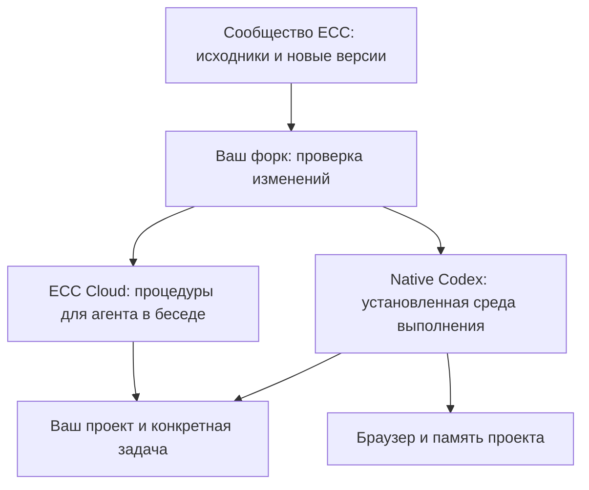

# ECC: возможности, контроль состояния и обслуживание

Это руководство для владельца установленного ECC. Срез проверки: **16 октября
2026 года**. Точные версии и ожидаемые свойства записаны также в
[машиночитаемой базе](ecc-deployment-baseline.json), фактическая приёмка — в
[журнале развёртывания](CODEX-NATIVE-STATUS.md).

## Что у вас есть

**ECC Cloud** — выбранный в беседе вход в библиотеку рабочих процедур ECC.
Агент получает инструкции по планированию, реализации, проверке и работе с
конкретной технологией. Основная модель остаётся моделью выбранной задачи.

В вашем форке сохранены собственная адаптация и воспроизводимый рецепт установки.
В текущем облачном окружении отдельно работает native Codex с ECC: там проверены
запуск модели, стартовый hook, браузер, память и автоматическое рассмотрение
запросов команд. Выбор плагина в беседе не переносит файлы Mac и не переносит
контейнер в другую виртуальную машину.

В установленном корпусе **311 исходных навыков**, **71 файл ролевых инструкций**,
**122 файла правил и руководства по их применению**. Native inventory дополнительно
содержит 37 совместимых командных входов. Это библиотека, из которой выбираются
нужные процедуры. Она не означает 311 постоянно запущенных программ или 71
автономного сотрудника. В проектной native-конфигурации зарегистрированы три роли:
исследователь кода, ревьюер и исследователь документации; реальная работа ревьюера
подтверждена.

## Какие задачи поручать

| Задача | Как сформулировать | Что доступно |
| --- | --- | --- |
| Ошибка в программе | «Воспроизведи ошибку, исправь и добавь проверку от повторения» | TDD, диагностика, verification-loop; реальный запуск проверен на нашем патче и 56 тестах |
| Новая функция | «Добавь импорт CSV; сначала уточни критерии готовности» | Планирование, реализация, тесты, проверка изменения |
| Проверка чужого кода | «Проверь PR на ошибки и пропущенные сценарии» | Общие и языковые роли ревью; отдельный native reviewer уже выполнял задачу |
| Сборка и CI | «Разберись с падением GitHub Actions на Windows» | Диагностика сборки, зависимостей и регрессий; конкретную ОС проверяют на подходящем runner |
| Веб-интерфейс | «Проверь форму заказа и мобильную верстку» | Браузерный MCP работает; полный пользовательский тест требует запущенного приложения и его данных |
| Архитектура | «Объясни проект и предложи план развития» | Изучение кода, API, архитектурные решения и оценка влияния изменений |
| Безопасность | «Проверь авторизацию перед выпуском» | Процедуры аудита и проверки; каждый аудит выполняется отдельно |
| Инфраструктура | «Подготовь Docker, CI и план выпуска» | Процедуры развёртывания; доступ к вашим серверам подключается отдельно |
| Сети | «Проанализируй конфигурацию и причину обрывов» | Сетевые процедуры; доступ к MikroTik/SSH и применимость команд проверяются отдельно |
| Память и документация | «Сохрани принятые решения и передай следующей задаче» | Память save/search/read проверена; знания проекта оформляются в его документации |
| Качество агентов | «Сравни два способа решения на одинаковых задачах» | Eval-процедуры; нужны набор задач, критерии и реальные измерения |
| Продукт и тексты | «Сравни конкурентов и подготовь обоснование функции» | Исследовательские, продуктовые и редакторские процедуры при наличии исходных данных |

Для каждой новой задачи задайте **проект, желаемый результат и способ проверки**.
Имена всех навыков запоминать не нужно. Агент выбирает подходящий набор и читает
полные исходные инструкции.

Пример:

> Используй ECC. В проекте X ошибка при запуске на Mac: … Исправь её, проверь
> тестами и подготовь PR. В итоговом отчёте укажи, что проверено именно на Mac,
> а что только в облаке.

## Как понять, что работа выполнена корректно

Иконка плагина подтверждает выбор плагина. Для результата нужны доказательства:

1. Агент назвал использованные процедуры и изучил правила вашего проекта.
2. Есть проверяемый результат: diff, PR, отчёт или воспроизводимая диагностика.
3. Указаны команды и результаты реально выполненных проверок, а не только план.
4. Явно отмечено, что не проверялось: нужная ОС, внешний сервис, полный набор тестов.
5. Значимые решения и найденные проблемы сохранены в документации или issues.

Работоспособность установки и качество конкретного исправления проверяются
раздельно. Исправный браузерный MCP не доказывает, что форма заказа работает;
успешный запуск модели не доказывает отсутствие ошибок в предложенном коде.

## Текущее состояние

| Область | Результат проверки |
| --- | --- |
| Cloud-пакет | 0.1.3: текущий опубликованный релиз подтверждён, входной навык прочитан |
| Native runtime | 16 октября: оба контейнера работают, ECC 2.2.3 включён, discovery без ошибок |
| Память | Реальный MCP doctor: 3 записи, 0 повреждённых записей, дубликатов и нарушенных ссылок |
| Браузер | Реальные snapshot и JavaScript-проверка контрольной страницы успешны |
| Разрешения | Одобренные владельцем постоянные настройки прочитаны повторно и сохранены |
| Модель и инженерная задача | 15 октября: Astra Ultra, чтение выбранных навыков, reviewer, 56/56 тестов, измеренное покрытие; 16 октября модельный запуск заново не повторяли |
| Диск | В проверке 16 октября перед созданием worktree руководства: 4,1 ГБ свободно, занято 87%; контролировать перед новыми сборками |
| Качество PR | PR #11: 43 успешные и 1 упавшая проверка; PR #9: 39 успешных и 4 упавших. Все завершены. Ошибки CI требуют разбора; ограниченная приёмка runtime не заменяет полный CI |

Для статуса используйте четыре значения: **проверено сейчас**, **есть прежнее
подтверждение с датой**, **нужен разбор ошибки**, **не удалось проверить**.
Если задача мониторинга не видит облачную машину, последняя категория обязательна.
Старый успешный отчёт нельзя автоматически превращать в сегодняшнее «всё работает».

## Что обновляется и кто это делает

| Компонент | Установлено | Опубликовано при проверке 16 октября |
| --- | --- | --- |
| ECC / ecc-universal | 2.2.3 | 2.2.3 |
| Codex CLI | 0.159.2 | 0.163.0 — требует проверки совместимости |
| Chrome DevTools MCP | 1.10.1 | 1.11.0 — требует проверки совместимости |
| Наш ECC Cloud | 0.1.3 | Собственный пакет, обновляется отдельной публикацией |

Сверка с upstream `76aaa77d` не выявила расхождений в установленных canonical
skills, agents, rules, hooks, native manifest и MCP manifest. В форке отсутствуют
три upstream-коммита, затрагивающие модерацию PR/CI; это не пропущенные новые
навыки. Полнота файлов не означает выполнение всех процедур на всех платформах.

**Автоустановка обновлений не включена.** Изменение GitHub-ветки не обновляет
опубликованный Cloud-плагин или уже установленный native cache. Эти три состояния
нужно сверять отдельно.

Порядок обновления для агента:

1. Сравнить release, commit и содержимое с закреплёнными версиями; объяснить пользу
   и возможную несовместимость, проверить нужные изменения в отдельной ветке.
2. Сохранить сведения о рабочем образе, исходном pin и предыдущем Cloud release.
   Не удалять старый образ до приёмки нового; проверить свободное место.
3. Собрать кандидат. Изменения Codex и браузерного MCP проверять по отдельности,
   чтобы источник регрессии был понятен. Не подменять активный проект или профиль.
4. Проверить discovery, полное чтение выбранных навыков, hook, browser/HTTPS,
   память и одну небольшую реальную задачу моделью. Изменившиеся hooks пересмотреть
   перед доверием. Запустить релевантные тесты и проверить CI соответствующего SHA.
5. Cloud-пакет собрать из проверенных исходников и обновить **тот же plugin ID**,
   сохранив владельца и настройки отображения; прочитать опубликованные файлы
   обратно. Native pin/image обновить отдельно.
6. Повторить запуск нового процесса, записать результаты и доступный путь отката.
   При несовместимости сохранить рабочую версию и зарегистрировать проблему.

Команда владельца: «Обнови ECC и связанные инструменты через проверяемую ветку;
покажи, что изменилось, проверь совместимость и сохрани возможность отката».

## Регулярный контроль

**Решение владельца: общий порядок для всех MCP и плагинов.** Созданное отдельное
расписание «ECC: состояние и обновления» приостановлено 16 октября до первого
выполнения. Постоянный общий мониторинг ещё не развёрнут. ECC должен стать одним
из объектов общей системы, без отдельного сервиса или расписания на каждый MCP.
Проверенные варианты и этапы внедрения описаны в
[плане общего обслуживания](MCP-FLEET-OPERATIONS-PLAN.md).

Общий отчёт должен включать:

- Текущие установленные и опубликованные версии с датой проверки.
- Доступность Cloud-навыка и, при доступе к нужному хосту, native inventory,
  состояние контейнеров, памяти, браузера и свободного диска.
- Открытые дефекты и результаты CI для актуальных коммитов PR.
- Новые возможности, полезные владельцу, и конкретный следующий шаг.

Внешний контроль GitHub и релизов не зависит от сохранения локального checkout.
Проверка runtime требует доступа именно к установленной среде. При его отсутствии
отчёт должен сообщить об этом; нельзя автоматически создавать другую VM и называть
её проверкой прежней установки. Рутинная проверка состояния не требует нового
входа в аккаунт, изменения разрешений или запуска полной тестовой матрицы.

Сбор метрик и оповещения должны работать в постоянной системе мониторинга.
Задача ChatGPT может объяснять её результаты, но не заменяет этот сбор.
Отчёт не устанавливает обновления, не сливает PR и не меняет внешние системы.
Резервное копирование и проверка восстановления — отдельные функции обслуживания.

В форке есть CI упаковки, конфигурация Dependabot и upstream-workflows обслуживания.
Наличие YAML не доказывает выполнение по расписанию. Кроме того, они не проверяют
память и браузер установленного контейнера. Не следует включать все чужие
workflows вслепую: например, общий maintenance workflow содержит автоматическое
закрытие давно неактивных issues/PR.

Отдельно подтверждён реальный автоматический запуск Supply-Chain Watch:
[16 октября, 04:30 UTC — SUCCESS](https://github.com/alexpostnik/ECC/actions/runs/38850995976).
Он проверяет зависимости и признаки проблем цепочки поставок в репозитории;
это полезная дополнительная проверка, но не контроль всего установленного ECC.

## Что не включено автоматически

- Все hooks Claude Code: в Codex проверен поддерживаемый SessionStart.
- Обучение на каждом действии и автоматическое сохранение всех чатов: память
  содержит явно сохранённые знания, а не полный архив разговоров.
- Доступ ко всем внешним сервисам, Mac, Kubernetes или сетевому оборудованию:
  инструкции могут быть в библиотеке, но доступ и инструменты нужны отдельно.
- Автоматический перенос профиля и памяти при удалении облачной VM. Docker volume
  сохраняет данные при пересоздании контейнера на том же хосте; отдельное
  зашифрованное резервное копирование и проверка восстановления не настроены.
- Одновременная загрузка всех навыков: Codex сокращает видимый каталог. Проверен
  явный выбор нужных skills из полного inventory и чтение их до конца.

## Как накапливать улучшения и участвовать в сообществе

Ошибка приложения идёт в issues приложения. Ошибка ECC или адаптации — в
[issues нашего форка](https://github.com/alexpostnik/ECC/issues) с воспроизведением,
версиями и ожидаемым результатом. Исправление сопровождается проверкой от повторения,
небольшим diff и ревью. Общий полезный патч можно оформить отдельным PR в upstream;
создание PR не означает, что сообщество уже приняло изменение.

Личные рабочие заметки хранятся в приватной памяти; принятые командные решения —
в репозитории проекта. Токены, auth-файлы и приватная память не публикуются в Git.
Нашу адаптацию и общие изменения ECC следует держать различимыми, чтобы обновления
сообщества оставались проверяемыми.

Владелец определяет цель и приоритет. Агент подбирает процедуры, выполняет проверки,
ведёт журнал и сообщает о границах результата. Для начала следующей задачи
достаточно: «Используй ECC; вот проект, вот проблема, вот ожидаемый результат».
