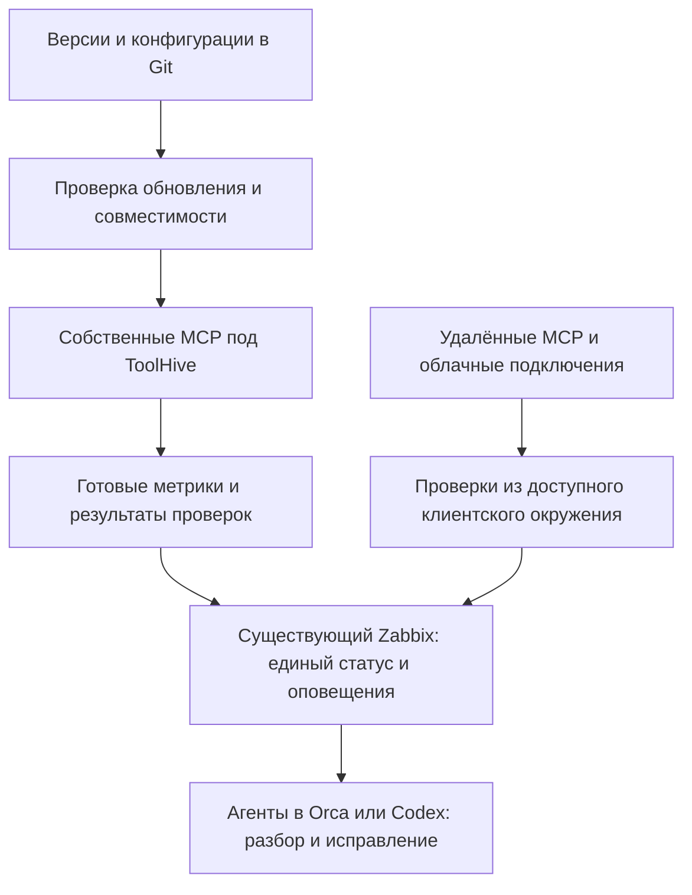

# Общий порядок обслуживания MCP и плагинов

Дата исследования: **16 октября 2026 года**. Статус: **проверенная рекомендация
и план пилота, не развёрнутая система мониторинга**. ECC работает по отдельной
[приёмке](ECC-OPERATIONS.md); работоспособность нового fleet-контура не заявляется.

Владелец выбрал общий механизм для десятков/сотен подключений. Отдельное расписание
ECC приостановлено до первого запуска. Новый gateway, collector, Zabbix template,
Renovate, Kubernetes и production-изменения в этой задаче не устанавливались.

## Рекомендация

Использовать существующий **Zabbix как общий экран состояния и оповещения**.
Для собственных MCP проверить **ToolHive на одном существующем Docker-хосте**:
это готовый менеджер запуска, конфигурации, метрик и обновлений. Orca/Codex оставить
средой работы агентов, которые диагностируют сбои и готовят проверяемые изменения.
Отдельный собственный MCP-daemon и кластер Kubernetes для начала не нужны.

Это целевая схема. Стрелки к Zabbix ещё требуют настройки и приёмки.
Совместимость ToolHive с нашими MCP, managed proxy и способом авторизации пока
не проверена. Подключать к нему все существующие сервисы сразу нельзя считать
доказанным решением.

## Готовые средства

| Средство | Подтверждённая функция | Ограничение / место в схеме |
| --- | --- | --- |
| [ToolHive](https://docs.stacklok.com/toolhive/guides-cli/run-mcp-servers) | CLI на Docker/Podman; контейнерные stdio/HTTP MCP и подключения к remote HTTP | Кандидат для собственного runtime; Kubernetes не обязателен; перенос текущей конфигурации требует пилота |
| [ToolHive v0.54.0 upgrade](https://github.com/stacklok/toolhive/blob/v0.54.0/docs/arch/08-workloads-lifecycle.md#upgrade) | Выпущены `thv upgrade check` и `thv upgrade apply` | Работает для workloads из registry с сопоставимыми версиями; произвольные image refs не покрыты; автоматического rollback нет |
| [ToolHive observability](https://github.com/stacklok/toolhive/blob/v0.54.0/docs/observability.md) | Prometheus-метрики и OpenTelemetry | Телеметрия не доказывает корректность каждого бизнес-инструмента; конкретный набор метрик проверяется в пилоте |
| [ContextForge](https://github.com/IBM/mcp-context-forge) | Общий registry/gateway, health checks, метрики и управление доступом | Альтернатива при потребности в центральном шлюзе; обновление каталога инструментов не равно обновлению бинарников MCP |
| [Docker MCP Gateway](https://docs.docker.com/ai/mcp-catalog-and-toolkit/mcp-gateway/) | Каталог, подключение и запуск поддерживаемых контейнерных MCP | Подходит для Docker-набора; не заменяет мониторинг всех внешних коннекторов и проверку совместимости |
| [Zabbix LLD](https://www.zabbix.com/documentation/7.0/en/manual/discovery/low_level_discovery) | Создаёт элементы и триггеры по общему discovery-правилу | Нужны источник данных и один общий шаблон, а не отдельная ручная настройка каждого экземпляра |
| [Zabbix Prometheus checks](https://www.zabbix.com/documentation/7.0/en/manual/config/items/itemtypes/http/prometheus) | Забирает и разбирает готовые метрики | Отдельный Prometheus-сервер только ради сбора этих метрик не обязателен |
| [Renovate managers](https://docs.renovatebot.com/modules/manager/) | Предлагает обновления package/image pins в Git | Не устанавливать параллельно Dependabot для тех же зависимостей; PR не является выполненным развёртыванием |

Выбор для первого пилота — **ToolHive + существующий Zabbix**. ContextForge и
Docker Gateway остаются альтернативами, а не двумя дополнительными обязательными
компонентами. Для зависимости, которую уже ведёт Dependabot, сохраняется этот
владелец обновлений. ToolHive upgrade и Git-конфигурация должны оставаться
согласованными; нельзя создавать два конкурирующих источника желаемой версии.

## Что уже есть у владельца

Read-only анализ `server-ops` выполнен по локальному commit `c7f0a63`, без fetch
и без обращений к production. Это evidence из журнала, а не сегодняшний замер:

- Orca управляет локальными агентскими задачами, worktrees и терминалами на Mac.
  Его [проверенные возможности](https://github.com/alexpostnik/server-ops/blob/c7f0a63/planning/2026-10-09-orca-capabilities.md)
  не включают постоянный мониторинг MCP.
- Последняя предметная [запись Zabbix](https://github.com/alexpostnik/server-ops/blob/c7f0a63/docs/2026-10-11-zabbix-mcp-permissions-assessment.md)
  от 11 октября указывает 7.0.29. Готовность MCP в desktop 12 октября не является
  проверкой всех API или повторной проверкой runtime Orca.
- В [findings](https://github.com/alexpostnik/server-ops/blob/c7f0a63/audits/findings.json)
  остаются FND-0083 (полнота сбора), FND-0084 (доставка оповещений),
  FND-0086 (восстановление требует перепроверки), FND-0099 (видимость credential
  macros). Поэтому работающий канал уведомлений ещё нужно подтвердить.
- Общий MCP inventory, LLD-шаблон и единый updater в просмотренном tracked
  `server-ops` не найдены. Это не доказывает отсутствие других настроек на Mac.

## Общие правила для всех подключений

### Учёт и принадлежность

Один источник конфигурации и одна запись на экземпляр. Идентификатор включает
хост, клиентский профиль, scope и имя сервера: одинаковое имя на двух машинах
не означает один сервис. Нужны владелец, транспорт, источник пакета, установленная
и одобренная версия, режим работы, профиль проверки и дата последнего результата.
Использовать registry/runtime inventory готового менеджера; тонкое сопоставление
с Zabbix допускается. Полный самописный реестр без установленной необходимости
не разрабатывать.

В метрики и Git попадают только разрешённые технические поля. Секреты и содержимое
вызовов остаются в существующих хранилищах; сырые аргументы команд и URL могут
содержать credentials и не должны становиться labels.

### Разные объекты под общим порядком

| Объект | Что проверять | Кто обновляет |
| --- | --- | --- |
| Собственный контейнерный MCP | Runtime, протокол, доступ к зависимости, безопасный функциональный сценарий | Наш процесс обновления через проверенный package/image |
| Локальный stdio MCP на Mac | Запуск из нужного профиля, протокол и выбранная операция | Локальный менеджер; отсутствие процесса вне задачи не означает аварии |
| Remote MCP | Доступность из нужной сети, авторизация, разрешённый discovery и сценарий | Владелец сервера; наше управление зависит от доступа |
| Managed cloud connector | Доступность конкретной операции в предоставленном runtime | Провайдер; package version или прямой endpoint могут быть недоступны |
| Плагин ECC Cloud | Опубликованный релиз, discovery, чтение выбранных инструкций и реальная задача | Наш private package; не устанавливается MCP-updater автоматически |

Сон Mac, недоступность среды сборщика и отсутствие доступа к endpoint — отдельные
статусы. Они не превращаются автоматически в «MCP сломан» или «MCP здоров».
Общий каталог не означает загрузку всех сотен инструментов в каждую беседу:
к задаче подключается необходимый набор.

### Доказательства исправности

1. Есть свежие данные от сборщика и ожидаемое окружение доступно.
2. Runtime и транспорт работают; измеряется задержка и категория отказа.
3. Установлен совместимый протокол и доступен разрешённый каталог возможностей.
4. Выполнен явно выбранный безопасный сценарий или есть свежее подтверждение
   такого сценария из реального использования.
5. После обновления повторены контрактные проверки и восстановление предыдущей
   версии. Расширение разрешений или изменение инструмента видно при review.

Нельзя проверять все write-tools произвольными вызовами. Для каждой реализации
достаточно повторно используемого профиля проверки с параметрами. Открытый порт,
HTTP 200 или успешный `tools/list` по отдельности не доказывают работу приложения.
Проверки учитывают версию протокола: официальный
[MCP SDK](https://go.sdk.modelcontextprotocol.io/protocol/)
различает старый initialize-handshake и новый lifecycle, поэтому один жёстко
зашитый ping/initialize не является универсальным тестом.

### Обновления

Обнаружение новой версии → одно изменение желаемой версии → проверка в отдельной
среде → ограниченное применение → повторная приёмка. Предыдущий image/config
сохраняется для отката. Метрики и уведомления используют стандартную систему;
автослияние и непроверенная автоустановка всех MCP не включаются.

Raw image, npm/Python packages и managed services покрываются их поддерживаемыми
менеджерами. Общая политика не требует делать вид, что один updater умеет менять
серверный код любого облачного провайдера.

## Что даёт сам ECC для обслуживания

[MCP inventory](../scripts/mcp-inventory.js) экспортирует статическую конфигурацию
в формате `ecc.mcp.v1`. Это входные данные, а не живой монитор. Его readers не
покрывают все runtime, некоторые ошибки превращаются в пустой список, а записи
объединяются по имени. Пустой результат нельзя объявлять отсутствием MCP.

[MCP health hook](../scripts/hooks/mcp-health-check.js) обслуживает события Claude.
В текущем Codex установлен только SessionStart. Hook считает HTTP 401/403/404
признаком достижимости, а stdio проверяет выживанием запущенного процесса в течение
пяти секунд. Это не полноценная MCP-проверка. Он может запускать процессы,
reconnect и писать cache, поэтому переносить его в общий cron вслепую нельзя.

ECC полезен как набор процедур аудита, исследования, реализации и verification.
Он не заменяет существующий Zabbix или специализированный runtime manager.

## План внедрения и критерии готовности

1. **Общий список объектов.** Из известных конфигураций собрать metadata,
   классифицировать owned/managed, host/profile и режим работы. Не извлекать
   credentials и не переподключать уже работающие сервисы без необходимости.
2. **Один пилот ToolHive.** На согласованном существующем execution host проверить
   выпущенную закреплённую версию: stdio, HTTP и нужную схему авторизации/proxy.
   Тестовые данные изолировать от памяти и профиля работающего ECC.
3. **Один Zabbix template.** Принять штатные метрики runtime и discovery, показать
   состояния/свежесть/задержку; profile-specific проверки добавлять как данные.
   Убедиться, что версия/метрики действительно выдаются, а не придумать их имена.
4. **Проверить оповещения.** Закрыть неопределённость FND-0083/FND-0084:
   контролируемая ошибка на тестовом объекте → событие → получение уведомления →
   recovery. Потеря данных самого сборщика также должна быть видна.
5. **Проверить обновление.** Одна новая версия, сценарий совместимости, повторный
   запуск и фактический откат. Registry-only ограничения ToolHive зафиксировать.
6. **Расширять через конфигурацию.** Добавление следующего MCP должно требовать
   записи и выбора готового профиля, без нового cron, агента или отдельного скрипта.
   Пилот не доказывает производительность на сотнях серверов: рост проверяется
   отдельно по ресурсам, rate limits и нагрузке на мониторинг.

Применение к production Zabbix и перенос работающих сервисов оформляются в
`server-ops` по его штатному workflow с конкретным target, проверкой и откатом.
В текущей задаче подготовлена основа этого этапа; production не изменялся.
